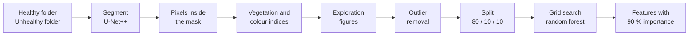

# RootIMdaExtractor


# RootSegExtration

A local tool that turns two folders of plant pictures, one **healthy** and one **unhealthy**, into a
labelled pixel dataset and a ranked list of the spectral features that separate the two classes.

It segments the plant in every picture with a trained U-Net++ network, reads the spectral values of the
pixels inside the mask, computes vegetation and colour indices, removes outliers, splits the data and
selects the most important features. It works with RGB photographs and with hyperspectral cubes.

Everything runs on your own computer. The program is a small web server on `127.0.0.1` and one page in
the browser; no picture or result is sent anywhere.

## What it does



1. **Segments** the plant in every picture and writes one boundary file (JSON), one mask and one overlay
   per picture.
2. **Reads the pixels** inside each mask and labels them by their folder: healthy = 1, unhealthy = 0.
3. **Computes every index** the available bands allow: 36 colour features for photographs, up to 105
   vegetation indices for hyperspectral cubes, depending on their wavelength range.
4. **Draws exploration figures**: histograms per class, spectra, box plots, correlations, PCA.
5. **Removes outliers** per class and saves the clean dataset.
6. **Splits** the clean dataset into training (80 %), validation (10 %) and test (10 %).
7. **Tunes a random forest** by grid search on the training set and ranks the features.
8. **Selects the smallest set of features** that carries 90 % of the importance.
9. **Writes a report** (`report.html`) with the key numbers and all figures.

Root pictures and shoot pictures are analysed separately. Each group gets its own tables, figures and
classifier (see [Root pictures and shoot pictures](#root-pictures-and-shoot-pictures)).

## Installation

The tool was developed and tested with Python 3.14 on Windows 11. It is plain Python, so other systems
should work with `python app.py`, but they have not been tested.

1. Install [PyTorch](https://pytorch.org/get-started/locally/) for your system. Choose the CUDA build if
   you have an NVIDIA GPU. Without a GPU the tool still works, but the segmentation takes 15–20 s per
   photograph instead of about 1 s.
2. Install the other packages:

   ```bash
   pip install numpy pandas scipy scikit-learn opencv-python pillow tifffile matplotlib joblib segmentation-models-pytorch fastapi uvicorn psutil
   ```

   `psutil` is optional. With it the tool chooses the number of worker processes from the physical cores
   and the free memory.
3. Put the network weights in `models/unetpp_r34/best.pt` (see below).

Versions used for testing: numpy 2.5, pandas 3.0, scikit-learn 1.9, matplotlib 3.11, torch 2.11 (CUDA
12.8), segmentation-models-pytorch 0.5.0.

### Network weights

The segmentation network is a U-Net++ with a ResNet-34 encoder
([segmentation_models_pytorch](https://github.com/qubvel-org/segmentation_models.pytorch)). The weights
file `best.pt` is about 100 MB. If it is not in the `models/unetpp_r34/` folder of your copy, download it
from the Releases page of this repository and put it there. `models/unetpp_r34/model_info.json` describes
the input, the output and how to rebuild the network.

The network was trained on photographs of washed roots (6000 × 4000 px) lying on a blue or near-black
board. Its training masks were produced automatically, not drawn by hand.

## Quick start

1. Start the tool. On Windows, double-click **`run.bat`**. On any system:

   ```bash
   python app.py
   ```

   A console window opens and the browser shows `http://127.0.0.1:8773/`. Keep the console window open
   while you work. Close it, or press Ctrl+C, to stop the tool. Options: `--port 8780`, `--host`,
   `--no-browser`.
2. **Step 1: Choose folders.** Pick the healthy folder and the unhealthy folder. The page shows how many
   photographs and cubes it found, and how many are root pictures and shoot pictures. The output folder
   is filled in for you (`RootSegExtration_output` next to the healthy folder). An optional name filter
   keeps only files whose name contains a text, for example `_root`.
3. **Step 2: Run.** One button. The bar shows the nine stages, the current picture and the time left.
   *Stop* ends the run at the next safe point. The page can be closed or reloaded while the run goes on.
4. **Step 3: Results.** Key numbers, the selected features, all figures, links to the tables, the report
   and the output folder.

Choosing the output folder of an earlier run in step 1 shows its results again without running anything.

`run.bat` looks for Python 3.14 in its default per-user location, then tries `py -3.14`, then `python`.
Edit the `PY` line in the file if your Python is somewhere else.

## How it works

| # | Stage | What happens | Result |
|---|---|---|---|
| 1 | Find the pictures | Both folders are read with their sub-folders. Folders ending in `_output` and files ending in `_mask`, `_label`, `_gt`, `_overlay` are skipped. | log |
| 2 | Segment | U-Net++ on 1024-px windows with 128 px overlap, blended; threshold 0.5; pieces under 20 px removed. Shoot pictures are then completed by the shoot segmentation. Pictures that already have an up-to-date mask are skipped. | `json/`, `masks/`, `overlays/`, `segmentation_summary.csv` |
| 3 | Extract pixels | Up to 5,000 random pixels inside each mask (reproducible; 0 = all pixels), read by up to 8 worker processes. | `<group>/1_dataset/` |
| 4 | Build the table | One row per pixel: image, label, class, x, y, the band values as stored, every index. | `<group>/1_dataset/` |
| 5 | Explore | Histograms per class, spectra or channel distributions, box plots, class balance, correlations, PCA. | `<group>/2_exploration/` |
| 6 | Remove outliers | Per class: invalid pixels, Tukey fences on the bands, robust Mahalanobis distance. Figures show what was removed. | `<group>/3_clean/` |
| 7 | Split | Stratified 80 / 10 / 10, by pixel (default) or by picture. | `<group>/4_split/` |
| 8 | Select features | Grid search of a random forest with 5-fold cross-validation grouped by picture, feature importance, cumulative 90 % selection, refit, scores on validation and test. | `<group>/5_features/` |
| 9 | Report | `report.html` and `run_summary.json`. | output folder |

`<group>` is `root_rgb`, `shoot_rgb`, `root_hyperspectral` or `shoot_hyperspectral`. A run may contain
several of them.

The segmentation is resumable: a second run into the same output folder does not segment the pictures
again. Stages 4 to 8 are always computed again and their folders are replaced, so a folder never mixes
two runs.

### Root pictures and shoot pictures

The network was trained on roots. On shoots it finds the stems but misses dark leaves. Pictures whose
file name contains `_upper` are therefore treated as **shoot pictures**: the network mask is only the
starting point, and `rse/shoot.py` completes it from the colour difference to the board. It also leaves
out the ruler, the paper labels and the colour card. Every other picture is a **root picture** and is
segmented by the network alone.

- Roots and shoots never share a table.
- The shoot segmentation marks a picture **check** when it is unsure. These pictures are still used, and
  the report lists them with their overlays and the reason.
- The text that marks a shoot picture and the switch *Analyse shoot pictures separately* are under
  **Advanced options**.

### All pixels

With **Pixels written per picture = 0** every pixel inside every mask is written. For a few hundred
24-megapixel photographs that is hundreds of millions of rows, which does not fit in memory. In that case:

- **The complete table goes straight to disk.** Worker processes each handle one picture and append
  their rows to `1_dataset/dataset_all_pixels.csv` in the order of the pictures. The main program never
  holds the table.
- **The statistics use a random sample** of at most 5,000 pixels per picture, saved as
  `dataset_analysis_sample.csv`. Exploration, outlier removal, split and feature selection describe that
  sample, and the report says so.
- **The tool checks the disk first.** It measures the size per row on the first picture and stops before
  writing if the file would not fit.
- **An interrupted run continues** where it stopped, as long as the options are unchanged.

Sizes and speeds measured on a workstation (16 cores, local SSD, 8 workers):

| Complete file contains | Speed | Size per row | 300 million rows |
|---|---|---|---|
| values + indices | 2.4 million rows/s | 332 bytes | about 92 GB |
| values only | 4.1 million rows/s | 48 bytes | about 13 GB |
| values + indices, compressed (`.csv.gz`) | 1.5 million rows/s | 181 bytes | about 50 GB |
| values only, compressed | 3.9 million rows/s | 11 bytes | about 3 GB |

Pictures on a network share are read much more slowly than local ones.

## Output folder

```
<output>/
  report.html                 summary with the key numbers and all figures (open this first)
  run_summary.json            the same numbers, machine-readable
  run_config.json             every option, program versions, weights, device, start and end time
  run_log.txt                 the full log with time stamps (runs are appended)
  segmentation_summary.csv    one row per picture: size, mask pixels, status, group, quality
  json/<image>.json           boundary polygons with holes; also opens in LabelMe
  masks/<image>.png           binary mask, 0 = background, 255 = plant
  overlays/<image>.jpg        the outline of the mask over the picture, for checking
  root_rgb/   shoot_rgb/   root_hyperspectral/   shoot_hyperspectral/     (those that have pictures)
    1_dataset/      dataset_all_pixels.csv, feature_list.csv, per_image_summary.csv
    2_exploration/  figures (*.png) and tables (*.csv): histograms, spectra, correlations, PCA, outliers
    3_clean/        dataset_clean.csv, outliers_removed.csv, outlier_summary.csv
    4_split/        train.csv, validation.csv, test.csv, split_summary.csv
    5_features/     grid_search_results.csv, best_params.json, feature_importance.csv,
                    selected_features.csv, metrics.json, the two fitted models (*.joblib),
                    train / validation / test tables with the selected features only, figures (*.png)
```

The tables are plain CSV (comma, UTF-8). `image` is the file name without its extension. The saved
models are dictionaries `{'model', 'features', 'classes', 'best_params', 'sklearn_version'}` and are
loaded with `joblib.load`.

## Options

The page shows the options that matter under **Advanced options**:

| Option | Default | Meaning |
|---|---|---|
| Pixels written per picture | 5000 | Random pixels inside each mask that go into the table file. 0 = every pixel. |
| Pixels per picture used for the statistics | 5000 | Only matters when more pixels are written than this. |
| Complete file contains | values + indices | *Values only* makes the complete file about 7 times smaller. |
| Compress the complete file | off | Writes `dataset_all_pixels.csv.gz`; pandas and R read it directly. |
| Shoot pictures: name contains | `_upper` | Text in the file name that marks a shoot picture. Alternatives: `_upper\|_shoot`. |
| Analyse shoot pictures separately | on | Off: every picture is treated as a root picture. |
| Shoot colour threshold | 0 (automatic) | Raise to 10–12 when shadow is taken as plant; lower to 6 when pale tissue is cut off. |
| Split | by pixel | *By picture* keeps all pixels of a picture together; needs at least 3 pictures per class. |
| Outlier removal | combined | *Combined* = invalid + Tukey fences + robust distance; or one of them alone; *Isolation Forest*; *none*. |
| Segmentation scale for hyperspectral cubes | 0 | Enlarges a cube 2–3 times before the network sees it. |
| Segment again pictures that already have a mask | off | Forces a new segmentation. |
| Grid search | trees 200, 400 · depth None, 10, 20 · leaf 1, 5 · features sqrt, 0.33 | Every combination is tried. |

All other options are in `rse/config.py` (`DEFAULTS`) and can be set when the pipeline is called from
Python:

```python
from rse import pipeline

summary = pipeline.run({'healthy_dir': r'D:\trial\healthy',
                        'unhealthy_dir': r'D:\trial\unhealthy',
                        'split_unit': 'image',
                        'max_pixels_per_image': 2000})
```

## Supported pictures

- **Photographs**: `.jpg`, `.jpeg`, `.png`, `.bmp`, and `.tif` / `.tiff` with up to 4 bands (8 or 16 bit).
  The EXIF rotation is not applied: masks and coordinates refer to the pixels as stored.
- **Hyperspectral cubes**:
  - ENVI: `name.hdr` plus the data file (`name`, `.raw`, `.dat`, `.img`, `.bil`, `.bip`, `.bsq` or `.bin`);
  - multi-band TIFF with more than 4 bands;
  - `.npy` and `.npz` arrays shaped (rows, columns, bands);
  - `.mat` (MATLAB up to v7; v7.3 files must be saved again with `-v7`).
- **Wavelengths** come from the ENVI header, or from `<name>_wavelengths.csv` / `.txt` or
  `wavelengths.csv` / `.txt` in the same folder (in nm). Without wavelengths the bands are numbered and
  no index is computed.

## How far the results can be trusted

- **Split by pixel shares pictures.** Validation and test pixels come from the same pictures as the
  training pixels, so those scores are optimistic and say nothing about new pictures or plants. Use
  *Split by picture* for that.
- **The label is the folder.** Every pixel of a picture in the unhealthy folder is labelled unhealthy,
  including tissue that looks sound. Any other difference between the folders (light, exposure, day,
  camera, background) is learned too.
- **Pixels are not independent.** The number of independent observations is the number of pictures.
- **The network was trained on root photographs.** On other backgrounds, or on small hyperspectral
  cubes, it can miss the plant or include background. Always look at a few overlays.
- **Shoot masks are less certain than root masks.** The shoot segmentation is a rule-based completion of
  the network mask, not a network trained on shoots. Tendrils lying on labels or on the colour card are
  only partly followed, very thin dark tendrils may be missed, and roots still attached to the stem base
  are included. Look at the pictures marked **check**.
- **Hyperspectral reading was tested on synthetic cubes only.** Check the first results on real cubes
  with care.
- **Importance is shared between correlated features.** Many indices use the same bands, so the ranking
  inside such a group is arbitrary. When the classifier is close to chance (balanced accuracy near
  0.5), the ranking means nothing, and the report says so.
- **Index references.** The literature reference stored with each index in `rse/indices.py` has not yet
  been checked against the original papers. Verify a formula and its source before you cite it.

## Adding an index

Open `rse/indices.py`. Two tables define every index, and adding one is adding one row.

For photographs (`RGB_CATALOGUE`):

```python
('MyIndex', 'colour index', '(R - B) / (R + B)', 'R,B', 'Author 2020',
 lambda v: _div(v.R - v.B, v.R + v.B)),
```

For hyperspectral cubes (`HS_CATALOGUE`), where `b(λ)` is the reflectance at λ nm:

```python
('MyNDI', 'pigment', '(R750 - R705) / (R750 + R705)', [750, 705], 'Author 2020',
 lambda b: _div(b(750) - b(705), b(750) + b(705))),
```

A hyperspectral index is computed only when every wavelength it needs lies within 10 nm of a band of
the cube. The new column then appears in the tables, the figures and the feature ranking without any
other change.

## Tests

```bash
python tests/run_core.py
```

`run_core.py` covers reading, segmentation and extraction; `run_ml.py` covers indices, outliers, split
and feature selection on synthetic pixels; `run_e2e.py` runs the whole pipeline; `run_stream.py`
measures the all-pixels path; `run_shoot.py` tests the shoot segmentation. Each prints `PASSED` at the
end. Some suites use example photographs from `tests/_data/`; without them, those parts cannot run.

## Files

```
app.py          the local server (port 8773)
index.html      the page
run.bat         starts app.py on Windows
SPEC.md         the design contract
models/unetpp_r34/        best.pt (weights), model_info.json
rse/config.py             options and their defaults
rse/io_images.py          reading photographs and hyperspectral cubes
rse/segment.py            U-Net++ segmentation, masks, boundaries, overlays
rse/shoot.py              the shoot segmentation
rse/extract.py            pixels inside the mask
rse/stream.py             worker processes; the complete table streamed to disk
rse/indices.py            vegetation and colour indices
rse/dataset.py, explore.py, outliers.py, split.py, features.py, plots.py    the statistics
rse/pipeline.py, report.py                                                  the run and its report
```
